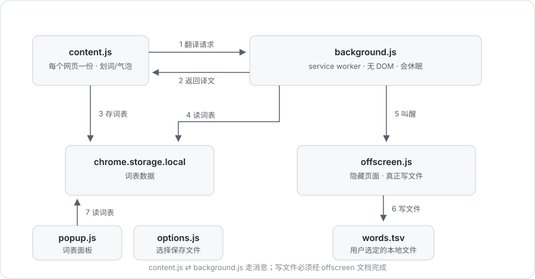
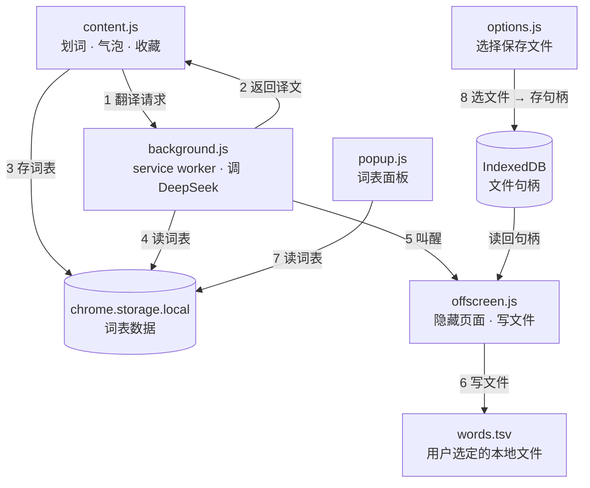

# Dia Translator · 实现详解

> 一个基于 Chrome Manifest V3 的**划词翻译 + 生词本**浏览器扩展。
> 选中网页任意文字 → 调用 DeepSeek 翻译 → 在选区旁弹出气泡 → 点 ☆ 收藏 → 自动写入本地 TSV 词表。

本文只讲**它是怎么被实现出来的**：为什么这样分层、每个文件解决什么问题、关键 API 怎么用、有哪些坑。
各源码文件内已逐段写了中文注释，阅读时请对照着看。

---

## 目录

- [1. 功能一览](#1-功能一览)
- [2. 快速开始](#2-快速开始)
- [3. 技术栈](#3-技术栈)
- [4. 架构总览](#4-架构总览)
- [5. 目录结构](#5-目录结构)
- [6. 模块详解](#6-模块详解)
- [7. 核心流程](#7-核心流程)
- [8. 关键技术点](#8-关键技术点)
- [9. 数据结构](#9-数据结构)
- [10. 错误处理](#10-错误处理)
- [11. 调试方法](#11-调试方法)
- [12. 已知限制与改进方向](#12-已知限制与改进方向)
- [13. 常见修改指南](#13-常见修改指南)
- [14. 术语表](#14-术语表)

---

## 1. 功能一览

| 功能 | 触发方式 | 实现位置 |
|---|---|---|
| 划词翻译 | 在网页上选中文字并松开鼠标 | `content.js` → `background.js` |
| 翻译气泡 | 自动出现在选区上方/下方 | `content.js` 的 Shadow DOM |
| 收藏单词 | 点气泡右侧的 ☆ | `content.js` → `chrome.storage.local` |
| 自动存文件 | 收藏后自动同步 | `background.js` → `offscreen.js` |
| 查看/复制词表 | 点浏览器工具栏图标 | `popup.js` |
| 下载 TSV | 弹窗里的「下载 words.tsv」 | `popup.js` |
| 指定保存文件 | 设置页「选择保存文件」 | `options.js` → `file-store.js` |

翻译方向是**自动判断**的：原文是英文就译成中文，原文是中文就译成英文（由系统提示词决定，见 [8.6](#86-翻译提示词与分块)）。

---

## 2. 快速开始

### 2.1 准备 API Key

在项目根目录创建 `.env`（可从 `.env.example` 复制）：

```dotenv
DEEPSEEK_API_KEY=sk-xxxxxxxxxxxxxxxx
```

> ⚠️ `.env` 会被**打包进扩展**。它只适合本地自用；如果要发布到商店，必须改成让用户自己填写、并存在 `chrome.storage` 里。

### 2.2 加载扩展

1. 打开 `chrome://extensions`
2. 右上角打开「开发者模式」
3. 点「加载已解压的扩展程序」，选择本项目目录
4. 记下卡片上的 **Service Worker** 链接，调试后台时会用到

### 2.3 首次使用

1. 点工具栏图标 → 「设置保存文件」→ 选一个 `words.tsv`（不存在就新建）
2. 打开任意网页，选中一段英文
3. 气泡出现并显示译文；点 ☆ 收藏
4. 打开那个 tsv 文件，应该已经多了一行

### 2.4 改完代码之后

```
chrome://extensions 点「刷新」  →  再刷新正在测试的网页（必须！）
```

只做第一步，页面里跑的还是旧版 content script，会报
`Cannot read properties of undefined (reading 'sendMessage')`。

---

## 3. 技术栈

| 层 | 用了什么 |
|---|---|
| 扩展框架 | Chrome Extension Manifest V3 |
| 语言 | 原生 JavaScript（无框架、无构建、无 npm 依赖） |
| UI | 原生 DOM + CSS（弹窗是普通 HTML，气泡是 Shadow DOM） |
| 持久化 | `chrome.storage.local`（词表）+ IndexedDB（文件句柄） |
| 网络 | `fetch` 调 DeepSeek 的 OpenAI 兼容接口 |
| 文件写入 | File System Access API（`showSaveFilePicker` / `createWritable`） |
| 隐藏页面 | `chrome.offscreen` API |

整个项目没有 `package.json`、没有打包步骤，改完源码直接重载即可——这是它最大的优点，也是理解成本低的根本原因。

---

## 4. 架构总览

### 4.1 四个运行环境

Chrome 扩展最反直觉的地方：**同一套代码被切分到多个互不相通的 JS 环境里**，它们之间不能直接调函数，只能发消息。





图中的编号与 [7. 核心流程](#7-核心流程) 的步骤一一对应。Mermaid 版比图片多画了一条「options → IndexedDB（存文件句柄）」的支线（第 8 步），图片版为排版简洁省略了。

| 环境 | 文件 | 有 DOM 吗 | 生命周期 |
|---|---|---|---|
| 内容脚本 | `content.js` | 有（宿主网页的） | 跟随网页，刷新即重建 |
| 后台 | `background.js` | 没有 | 空闲约 30 秒被浏览器回收 |
| 扩展页面 | `popup.*` / `options.*` | 有（自己的页面） | 关闭即销毁 |
| 隐藏页面 | `offscreen.*` | 有（不可见） | 由后台创建，直到被关闭 |

### 4.2 为什么必须分成四块

- **划线、画气泡**必须在网页里做 → 只能靠内容脚本注入。
- **调 API** 需要跨域权限，`host_permissions` 配在扩展层面，所以放在后台最稳。
- **弹窗/设置页**是用户主动打开的独立页面。
- **写本地文件**必须由用户手势触发选择框，且 service worker 拿不到文件句柄 → 只能借一个有 DOM 的隐藏页面。

只要理解了「谁有 DOM、谁能跨域、谁会被杀」，后面所有绕来绕去的代码都能解释通。

---

## 5. 目录结构

```
TransDia/
├── manifest.json      扩展配置：权限、入口、注入规则
├── .env               DeepSeek API Key（不提交）
├── .env.example       配置模板
│
├── content.js         注入网页：划词监听 + 翻译气泡 + 收藏
├── background.js      后台：消息路由 + 调 API + 调度写文件
│
├── popup.html         工具栏弹窗的界面
├── popup.js           弹窗逻辑：计数 / 复制 / 下载 / 打开设置
│
├── options.html       设置页界面
├── options.js         设置页逻辑：选文件 / 立即同步
│
├── file-store.js      IndexedDB 封装：保存、读取文件句柄
├── offscreen.html     隐藏页面（由后台动态创建）
├── offscreen.js       真正执行文件写入
│
├── README.md          本文：实现详解
├── 代码导读.md         文件地图 + 阅读顺序 + manifest 逐行说明
│
└── docs/
    └── architecture.svg   架构图（矢量，README 里引用的就是它）
```

---

## 6. 模块详解

### 6.1 manifest.json —— 扩展的「身份证」

它决定了 Chrome 怎么加载、给什么权限、在哪些网站注入脚本。关键字段：

| 字段 | 值 | 作用 |
|---|---|---|
| `manifest_version` | `3` | 使用 MV3（MV2 已被 Chrome 淘汰） |
| `host_permissions` | `https://api.deepseek.com/*` | 允许跨域请求 DeepSeek |
| `permissions` | `storage` | 使用 `chrome.storage.local` |
| | `offscreen` | 创建隐藏页面 |
| | `clipboardWrite` | 弹窗里写剪贴板 |
| `action.default_popup` | `popup.html` | 点图标弹出哪个页面 |
| `options_page` | `options.html` | 「扩展选项」入口 |
| `background.service_worker` | `background.js` | 后台脚本 |
| `content_scripts.matches` | `<all_urls>` | 所有网站注入 |
| `content_scripts.run_at` | `document_idle` | 页面基本加载完再注入，避免拖慢首屏 |

> JSON 不支持注释，所以逐行解释写在 `代码导读.md` 里。给这个文件加 `//` 会导致扩展直接加载失败。

**权限的代价**：`<all_urls>` + `content_scripts` 会让 Chrome 在安装时提示「读取和更改您在所有网站上的数据」。这是划词类扩展躲不掉的。

---

### 6.2 content.js —— 网页里的那部分

这是全项目最「重」的文件，因为它同时负责 UI、交互和与后台通信。

#### 结构

```
常量 BUBBLE_CSS       气泡样式（字符串）
模块变量               bubble / textEl / starBtn / currentWord / ...
mouseup 监听           入口
ensureBubble()         懒创建 Shadow DOM
showBubble()           主流程：占位 → 请求 → 渲染
placeBubble()          定位算法
hideBubble()           销毁
translate()            发消息给后台
saveWord()             写 storage + 通知同步
```

#### 为什么用 Shadow DOM

网页自己可能有 `div { background: red; font-size: 30px }` 这种全局样式，普通气泡一定会被搞乱。

```js
bubble.style.cssText = "all:initial;position:fixed;z-index:2147483647;left:0;top:0;";
bubbleRoot = bubble.attachShadow({ mode: "open" });
bubbleRoot.innerHTML = `<style>${BUBBLE_CSS}</style> ... `;
```

- `all:initial`：把宿主 div 上的继承样式全部重置，网页的 `div{}` 影响不到它；
- `attachShadow`：内部成为一个独立的样式作用域，双向隔离；
- `position:fixed`：让气泡相对**视口**定位，`left/top` 直接用鼠标坐标算；
- `z-index:2147483647`：`2^31-1`，理论上能盖住页面里任何元素。

#### 事件监听

```js
document.addEventListener("mouseup", (e) => {
  if (bubble && bubble.contains(e.target)) return; // 点在气泡上不算新划词
  const text = window.getSelection().toString().trim();
  if (!text) return hideBubble();                  // 点空白处 → 收起
  const rect = window.getSelection().getRangeAt(0).getBoundingClientRect();
  showBubble(rect, text);
});
```

选 `mouseup` 而不是 `selectionchange`，是因为用户拖选过程中会触发几十次 `selectionchange`，只有松开鼠标才代表「这次选择结束了」。

#### 竞态处理

连续快速划两个词时，第一次的请求可能后返回，把第二次的结果覆盖掉。解决办法是自增序号：

```js
const myId = ++requestId;
translate(text).then((result) => {
  if (myId !== requestId) return; // 已经有更新的请求了，丢弃
  ...
});
```

---

### 6.3 background.js —— 后台服务员

#### 消息路由

```js
chrome.runtime.onMessage.addListener((message, sender, sendResponse) => {
  if (message.type === "translate") { ...; return true; }
  if (message.type === "syncWordsToFile") { ...; return true; }
});
```

两个细节：

1. **`return true` 必须写**。它告诉 Chrome「我会异步回复」。不写的话，等 `fetch` 回来时消息通道已经关闭，`sendResponse` 静默失效，前台收到 `undefined`。
2. **消息是广播的**。`chrome.runtime.sendMessage` 会发给所有扩展上下文（后台、弹窗、设置页、offscreen），每个 `onMessage` 都会收到。所以 `offscreen.js` 里必须先判断 `message.target === "offscreen"`，否则会自己处理自己的消息。

#### API Key 的读取

扩展读不到宿主机的环境变量，所以把 `.env` 当成扩展内的普通文件 fetch 出来，手工解析：

```js
const res = await fetch(chrome.runtime.getURL(".env"));
// 逐行解析 KEY=VALUE，跳过 # 注释，去掉首尾引号
```

`getEnv()` 用 Promise 缓存，保证只读一次。

#### 长文本分块

单次请求塞几千字既慢又容易被截断，所以按 1200 字切块，**串行**请求后拼接：

```js
async function translate(text) {
  const chunks = splitText(text, 1200);
  const results = [];
  for (const chunk of chunks) results.push(await translateChunk(chunk)); // 串行
  return results.join("\n");
}
```

`splitText` 会尽量在 `。！？\n` 处断句，找不到合适断点就硬切；循环保证每轮 `rest` 一定变短，不会死循环。

---

### 6.4 popup.html / popup.js —— 弹窗

弹窗每次点开都会重新加载整个页面，所以不需要监听 storage 变化，脚本一执行 `refresh()` 就够了。

**下载的实现**（浏览器没有直接写文件的 API）：

```js
const blob = new Blob([lines.join("\n")], { type: "text/plain;charset=utf-8" });
const url = URL.createObjectURL(blob);
const a = document.createElement("a");
a.href = url; a.download = "words.tsv"; a.click(); a.remove();
setTimeout(() => URL.revokeObjectURL(url), 1000);
```

这个套路在纯前端项目里到处都是。

**为什么复制成 TSV**：Quizlet、Anki 都支持「制表符分隔」的粘贴导入，一行一个词条。

---

### 6.5 options.html / options.js —— 设置页

设置页只做一件事：拿到 `FileSystemFileHandle` 并存起来。

```js
const handle = await window.showSaveFilePicker({ suggestedName: "words.tsv", types: [...] });
await saveFileHandle(handle);
```

注意点：

- 必须在**用户点击**的调用栈里调用，否则浏览器以「没有用户手势」拒绝；
- 用户点「取消」时抛 `AbortError`，属于正常分支，要 catch 掉；
- 句柄本身不能存 `chrome.storage`（它只接受 JSON 可序列化的数据），所以用 IndexedDB。

「立即同步一次」按钮并不自己写文件，而是发 `syncWordsToFile` 给后台。

严格说，设置页本身也有 DOM、也能拿到句柄，自己写是可行的；这样设计的真正原因是：
**service worker 写不了文件，必须统一走 `background → offscreen` 这条路**，
让「收藏后自动同步」和「手动同步」共用同一段写入代码。

---

### 6.6 file-store.js —— 句柄持久化

这是全项目最底层、也最「复古」的一段：IndexedDB 用事件回调，被 Promise 包了一层。

```js
indexedDB.open("transdia", 1)
  → 建表 handles
  → put(handle, "wordsFile")   // 存
  → get("wordsFile")           // 取
```

它被两个页面共享：

- `options.html` 选文件时调用 `saveFileHandle`；
- `offscreen.html` 写文件时调用 `loadFileHandle`。

所以它单独成一个文件，而不是塞在 `options.js` 里。

---

### 6.7 offscreen.html / offscreen.js —— 隐藏的写入者

`chrome.offscreen` 是 MV3 提供的官方方案：为一个「没有界面但需要 DOM 能力」的场景创建页面。

```js
await chrome.offscreen.createDocument({
  url: "offscreen.html",
  reasons: ["BLOBS"],
  justification: "Write collected words to the user's chosen local file",
});
```

`reasons` 必须从 Chrome 的枚举里选，选错会直接抛错。

写入流程：

```js
const handle = await loadFileHandle();                 // 取回句柄
let perm = await handle.queryPermission({ mode: "readwrite" });
if (perm !== "granted") perm = await handle.requestPermission({ mode: "readwrite" });
const writable = await handle.createWritable();        // 会清空原文件
await writable.write(text);
await writable.close();                                // close 才真正落盘
```

> `createWritable()` 是**整文件覆盖**，不是追加。所以每次收藏都会把全部词重新写一遍。词表上万条时这里会成为瓶颈（见[第 12 节](#12-已知限制与改进方向)）。

---

## 7. 核心流程

### 7.1 划词翻译

```
用户拖选并松开鼠标
  │
  ├─ content.js  mouseup
  │    ├─ getSelection().toString()            取文字
  │    ├─ getRangeAt(0).getBoundingClientRect() 取坐标
  │    └─ showBubble(rect, text)
  │         ├─ ensureBubble()                  首次创建 Shadow DOM
  │         ├─ textEl = "翻译中…" + .loading
  │         ├─ placeBubble(rect)               先按占位尺寸摆位置
  │         └─ translate(text)
  │              └─ chrome.runtime.sendMessage({type:"translate", text})
  │                   │
  ├─ background.js  onMessage
  │    ├─ splitText(text, 1200)                切块
  │    ├─ for chunk: translateChunk(chunk)
  │    │     └─ fetch(DeepSeek)                带 Bearer key
  │    └─ sendResponse({ok:true, result})
  │
  └─ content.js  .then(result)
       ├─ 校验 myId === requestId              丢弃过期结果
       ├─ textEl = result
       └─ placeBubble(currentRect)             文本变长后重新定位
```

### 7.2 收藏并落盘

```
点击 ☆ (content.js)
  ├─ saveWord(word, translation)
  │    ├─ chrome.storage.local.get("words")
  │    ├─ 已存在同名 → return（去重）
  │    ├─ push({word, translation, time})
  │    ├─ chrome.storage.local.set({words})
  │    └─ sendMessage({type:"syncWordsToFile"})
  │
  └─ background.js
       ├─ 读出 words → 拼成 "单词\t释义" 行
       ├─ ensureOffscreen()                    需要时创建隐藏页
       ├─ sendMessage({target:"offscreen", type:"write", text})
       │
       └─ offscreen.js
            ├─ loadFileHandle()                从 IndexedDB 取句柄
            ├─ 检查/申请 readwrite 权限
            ├─ createWritable() → write() → close()
            └─ sendResponse({ok:true})
```

### 7.3 首次配置

```
设置页 → 点「选择保存文件」
  → showSaveFilePicker()            用户在系统对话框里选文件
  → saveFileHandle(handle)          存进 IndexedDB
  → 之后每次收藏，offscreen 都能 loadFileHandle() 拿到它
```

---

## 8. 关键技术点

### 8.1 消息机制

| 场景 | API | 返回 |
|---|---|---|
| 发消息 | `chrome.runtime.sendMessage(msg)` | Promise（MV3 支持） |
| 收消息 | `chrome.runtime.onMessage.addListener` | 必须 `return true` 才能异步回复 |

`sendResponse` 只能调用一次，传什么就原样回到发送方的 `.then`。

### 8.2 气泡定位算法

```js
const { width, height } = bubble.getBoundingClientRect(); // 先量真实尺寸
let left = rect.left + rect.width / 2 - width / 2;        // 水平居中于选区
left = Math.min(Math.max(gap, left), innerWidth - width - gap); // 夹在视口内

let top = rect.top - height - gap;                        // 优先放上方
if (top < gap) top = rect.bottom + gap;                   // 上方不够 → 放下方
top = Math.min(top, innerHeight - height - gap);
```

难点在于**必须先渲染再测量**：气泡高度取决于译文长度，所以译文回来后还要再调一次 `placeBubble`。

### 8.3 暗色模式

纯 CSS 搞定，不需要 JS 判断：

```css
@media (prefers-color-scheme: dark) { .bubble { ... } }
```

### 8.4 「扩展上下文失效」

扩展被重载后，已经打开的标签页里那份 content script 会失去 `chrome.runtime`（变成 `undefined`）。此时调用 `sendMessage` 会抛
`Cannot read properties of undefined (reading 'sendMessage')`。

代码里用 `extensionAlive()` 先探测，再给出「扩展已更新，请刷新本页后重试」的提示。**根因是页面没刷新，不是代码 bug。**

### 8.5 MV3 service worker 会休眠

`background.js` 里的普通变量（比如 `offscreenReady`、`envPromise`）在 worker 被回收后会丢失。所以：

- 数据一律放 `chrome.storage` / IndexedDB；
- `ensureOffscreen()` 每次都要能安全地重新执行（创建失败就忽略）。

### 8.6 翻译提示词与分块

系统提示词决定了语气和方向：

```
把用户给出的文本翻译成中文；若原文是中文则译成英文。只输出译文，不要解释。
```

请求体是 OpenAI 兼容格式：

```json
{
  "model": "deepseek-chat",
  "messages": [{ "role": "system", "content": "..." }, { "role": "user", "content": "..." }],
  "temperature": 1.3,
  "stream": false
}
```

返回取 `data.choices[0].message.content`。

---

## 9. 数据结构

### 9.1 词表（`chrome.storage.local`）

```js
{
  "words": [
    { "word": "resilient", "translation": "有弹性的；能恢复的", "time": 1794018017000 }
  ]
}
```

- `word`：原文（选中文字，已 trim）
- `translation`：译文
- `time`：收藏时间戳（目前只存不用，方便以后做「按时间排序/导出」）

### 9.2 文件句柄（IndexedDB）

```
数据库：transdia (version 1)
object store：handles
记录：key = "wordsFile"  →  FileSystemFileHandle
```

### 9.3 导出的 TSV

```
resilient	有弹性的；能恢复的
ubiquitous	无处不在的
```

一行一个词条，`单词 <TAB> 释义`。写入前会把原文/译文里的 `\t\n\r` 替换成空格，保证不破坏行结构。

---

## 10. 错误处理

| 位置 | 情况 | 处理 |
|---|---|---|
| `translateChunk` | 没配 key | 抛「未配置 DEEPSEEK_API_KEY」 |
| `translateChunk` | HTTP 非 2xx | 抛 `DeepSeek <status> <前 120 字>` |
| `translateChunk` | 返回空 | 抛「DeepSeek 返回为空」 |
| `content.js` | 后台报错 | 气泡显示「翻译失败: …」 |
| `content.js` | 扩展已失效 | 气泡显示「扩展已更新，请刷新本页后重试」 |
| `saveWord` | 没选文件 / 写入失败 | 同步请求的结果被直接忽略（`.catch(() => {})` 只兜网络层异常），收藏本身仍然成功 |
| `options.js` | 用户取消选择 | 显示「已取消：…」 |
| `offscreen.js` | 无句柄 / 无权限 | 抛错，最终反馈到设置页的「同步失败」 |
| `ensureOffscreen` | 隐藏页已存在 | 捕获后忽略 |

设计取向：**翻译失败要让用户看见，保存失败可以静默**——因为词已经进 storage 了，下次同步还能补上。

---

## 11. 调试方法

| 想调什么 | 怎么做 |
|---|---|
| 气泡（content.js） | 网页里 F12 → Console；或临时插 `debugger;` |
| 后台（background.js） | `chrome://extensions` → 本扩展 → 点 **Service Worker** → Console |
| 弹窗（popup.js） | 打开弹窗 → 右键 → **检查** |
| 设置页（options.js） | 设置页里直接 F12 |
| 存储内容 | 后台 Console 执行 `chrome.storage.local.get(console.log)` |
| 消息流 | 在 `onMessage` 第一行 `console.log(message)` |

**三个高频问题**

1. 改了代码没反应 → 忘了重载扩展或刷新网页。
2. `sendResponse` 收到 `undefined` → 忘了 `return true`。
3. 气泡样式被网页带歪 → 检查是不是绕过了 Shadow DOM 直接 `document.body` 加节点。

---

## 12. 已知限制与改进方向

### 限制

| 限制 | 原因 |
|---|---|
| 只支持鼠标划词 | 只监听了 `mouseup`，键盘选择（Shift+方向键）不会触发 |
| 滚动后气泡不动 | `position:fixed` 固定在视口，网页滚动时气泡不跟随选区 |
| 不能删除单词 | popup 只有复制和下载，没有管理界面 |
| 每次收藏整文件重写 | `createWritable()` 是覆盖式写入 |
| 重新授权可能失败 | `requestPermission` 在无用户手势的 offscreen 里可能被拒 |
| key 明文打包 | `.env` 会随扩展一起分发 |
| 没有图标 | manifest 里没配 `icons`，显示默认拼图图标 |

### 可以往下做的方向

1. **词表管理页**：用 `options.html` 扩展成一个表格，支持删除、搜索、按时间排序。
2. **增量写入**：记录已写入的条数 `lastSyncedIndex`，每次只 append 新增部分。
3. **快捷键触发**：`commands` + `chrome.commands`，或 `Alt+T` 翻译当前选中。
4. **翻译缓存**：同一段文字重复划词时先查 `storage`，省 token。
5. **气泡跟随滚动**：监听 `scroll` 重新 `placeBubble`，或改用 `absolute` 定位。
6. **API Key 移到 storage**：设置页加一个输入框，用 `chrome.storage.sync` 保存。
7. **支持多语言方向**：提示词里加目标语言参数。
8. **流式输出**：`stream: true` + 逐字渲染，长文本体验会好很多。

---

## 13. 常见修改指南

| 想改的东西 | 改哪里 |
|---|---|
| 气泡样式（颜色/圆角/阴影/宽度） | `content.js` 顶部 `BUBBLE_CSS` |
| 翻译方向 / 语气 | `background.js` 的 `translateChunk` 里的 system 提示词 |
| 换模型 | `background.js` 的 `model` 字段 |
| 分块大小 | `background.js` 的 `splitText(text, 1200)` |
| 弹窗按钮与文案 | `popup.html` + `popup.js` |
| 扩展名称/版本/权限 | `manifest.json` |
| 新增一个消息类型 | `background.js` 的 `onMessage` 加分支 + 发送方加 `type` |

改完统一动作：**重载扩展 → 刷新测试页面**。

---

## 14. 术语表

| 术语 | 解释 |
|---|---|
| **Manifest V3** | Chrome 扩展当前的格式规范，后台改用 service worker |
| **content script** | 注入到网页里运行的脚本，能操作 DOM，但和网页 JS 变量隔离 |
| **service worker** | 后台脚本，无 DOM、无窗口，空闲会被回收 |
| **offscreen document** | 不可见的扩展页面，用来执行需要 DOM 的后台任务 |
| **Shadow DOM** | 把一段 DOM 及其样式与外部隔离的技术 |
| **FileSystemFileHandle** | 指向用户选定文件的句柄，可长期复用 |
| **IndexedDB** | 浏览器内置的对象数据库，能存句柄这类非 JSON 数据 |
| **TSV** | 制表符分隔的文本表格，一行一条记录 |
| **run_at: document_idle** | 注入时机：页面基本加载完，约 `DOMContentLoaded` 之后 |
| **return true** | `onMessage` 里表示「稍后异步回复」，不写会导致回复丢失 |

---

相关文档：`代码导读.md`（文件地图、阅读顺序、manifest 逐行说明）。
